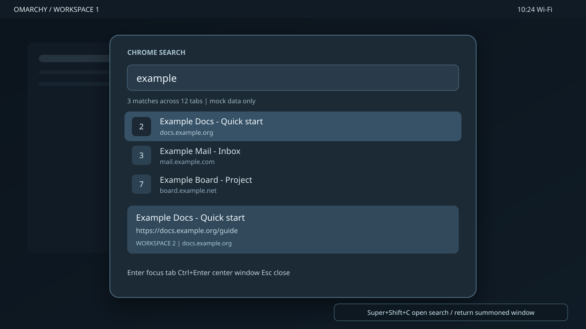
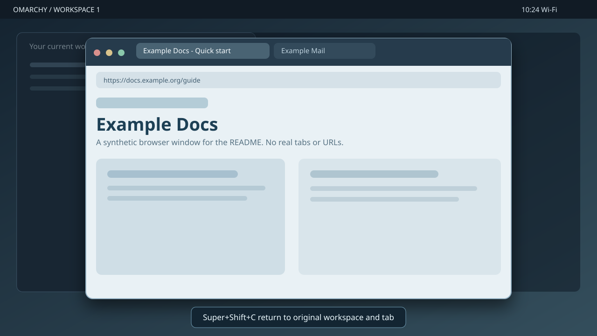

# Omarchy Chrome Search

A native [Omarchy](https://omarchy.org/) shell launcher for open Chrome tabs. Search by title or URL, see each tab's Hyprland workspace, and focus the exact tab/window. A second action temporarily summons the entire Chrome window over your current workspace without changing its original tiling layout.

The illustrations below are **synthetic mockups** made with reserved example domains. They are not captures of anyone's browser or desktop.





## Install

Requires Omarchy with `omarchy-shell` plugins, Google Chrome or Chromium, and Python 3. No remote-debugging flag or network listener is needed.

```sh
git clone https://github.com/hjanuschka/omarchy-chrome-search.git
cd omarchy-chrome-search
```

1. Open `chrome://extensions` in the browser you use. Turn on **Developer mode**, click **Load unpacked**, and choose this repository's `chrome-extension/` directory. Copy the extension ID shown on the card.
2. Register the native host and install the Omarchy plugin using **your** extension ID:

   ```sh
   python3 bridge/install.py YOUR_EXTENSION_ID
   omarchy-shell shell rescanPlugins
   omarchy plugin enable hjanuschka.chrome-search
   ```

3. Reload the extension once at `chrome://extensions`, then check the connection:

   ```sh
   omarchy-chrome-search list
   omarchy-shell shell toggle hjanuschka.chrome-search '{}'
   ```

4. Add a keybinding in `~/.config/hypr/bindings.lua`. For example, to replace the default Calendar shortcut:

   ```lua
   hl.unbind("SUPER + SHIFT + C")
   o.bind("SUPER + SHIFT + C", "Chrome Search / return window", "omarchy-chrome-search launcher")
   ```

   Run `hyprctl reload` and `hyprctl configerrors` to validate it. **Super+Enter remains the Terminal shortcut.**

The installer registers Native Messaging manifests for Google Chrome and Chromium, symlinks the QML plugin into `~/.config/omarchy/plugins/`, and creates `~/.local/bin/omarchy-chrome-search`. Keep the clone at the same path; after pulling updates, restart `omarchy-shell` for changes to its keep-loaded plugin. Other Chromium-based browsers need the host manifest in their own `NativeMessagingHosts` directory.

## Use

| Shortcut | Action |
| --- | --- |
| Super+Shift+C | Open Chrome Search; if a window is summoned, return it immediately instead |
| Enter in launcher | Focus the selected tab in its existing window |
| Ctrl+Enter in launcher | Summon the selected Chrome window over the current workspace |
| Up/Down, Escape | Select a result, close launcher |

Press **Super+Shift+C again from anywhere** to unsummon. You do not need to reopen the launcher. The original workspace, focused window, and previously active tab are restored. While Chrome is summoned, an Omarchy-shell window holds its original tiling slot, so returning it does not reorder the other tiles. You can also run `omarchy-chrome-search restore` from a terminal.

Only one Chrome window can be summoned at a time. Summoning a fullscreen window or one already in a special workspace is unsupported. If you close or restart `omarchy-shell` while a window is summoned, its placeholder disappears, so exact tiling restoration is no longer possible.

## Previews and permissions

The launcher shows a selected-tab detail panel with its full title, URL, and workspace. It does **not** capture page screenshots. Chromium's public API only captures visible tabs and would require the broad `<all_urls>` permission; background tabs cannot be screenshotted without activating them. It also does not expose Chromium's built-in omnibox autocomplete. If no tab matches, Enter searches using Chrome's default search engine.

The extension requests `tabs` (titles and URLs), `nativeMessaging` (local bridge), `search` (default search engine), and `alarms` (reconnect after Chrome suspends its service worker). The host exposes a user-private Unix socket under `$XDG_RUNTIME_DIR`; it does not listen on TCP. Only one browser profile can own that socket at a time.

## Development

```sh
python3 -m unittest discover -s tests -v
node --check chrome-extension/background.js
```
